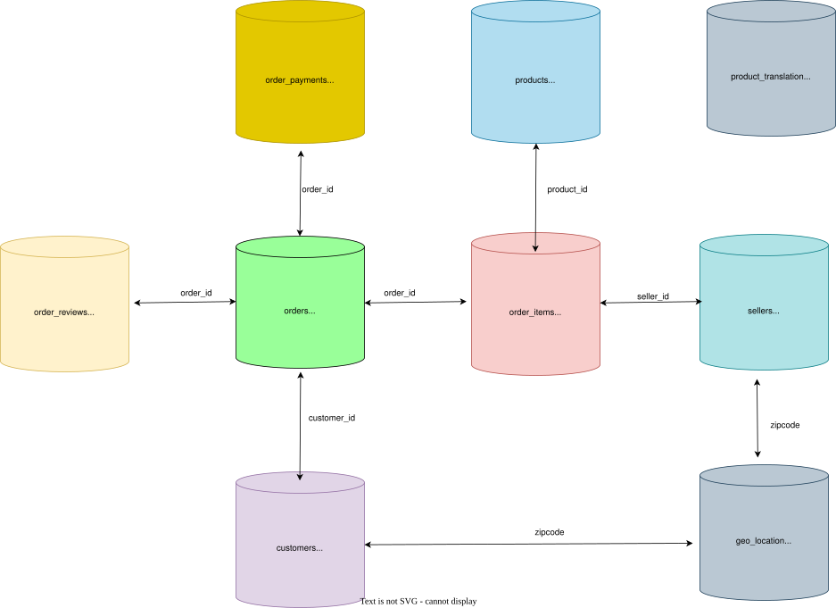

# Olist E-commerce Database & Customer Analytics

**PostgreSQL · SQL · Python notebooks · Customer, seller, product and order analytics**

A relational analysis of the public [Brazilian E-Commerce dataset by Olist](https://www.kaggle.com/datasets/olistbr/brazilian-ecommerce), covering approximately 100,000 orders from 2016–2018. This project recreates the relational schema and explores order frequency, customer patterns, merchant contribution and product performance.



**Explore the analyses:** [Orders](Frequency_analysis_of_orders/README.md) · [Customers](Customer_analysis/README.md) · [Sellers](Seller_analysis/README.md) · [Products](Product_analysis/README.md) · [Additional analyses](Miscellaneous/README.md)

**Related reproducibility study:** [Olist: p = 0 Is Not a Finding (Kaggle)](https://www.kaggle.com/code/senanuretin/olist-p-0-is-not-a-finding) — a separate review of statistical effect sizes using the same dataset.

## Analytical scope

| Area | Questions explored |
|---|---|
| Orders | How do transaction frequency and delivery timelines change? |
| Customers | Where are customers concentrated and how do purchases repeat? |
| Sellers | Which merchants contribute materially to GMV and order volume? |
| Products | Which categories and items shape the sales mix? |
| Other | Supplementary analyses in Jupyter notebooks |

These are historical public-data analyses, not live company reporting.

## Set up the database

**Requirements:** PostgreSQL, a local `olist` database and `psql` with CSV import privileges. The CSVs are present in `olist_data/`; the dataset source above remains the primary reference for provenance and usage rights.

```bash
git clone https://github.com/senanurcetin/olist_database_analysis.git
cd olist_database_analysis
createdb olist
psql -d olist -f create_table.sql
```

**Important:** `import_data.sql` contains `\\copy` commands with an original contributor's absolute local paths (for example, a previous machine's home-directory path). **Before importing, update those paths** to the absolute path of your local `olist_data/` directory, then execute:

```bash
psql -d olist -f import_data.sql
```

`\\copy` is a **psql client meta-command** and must be run using `psql`, not pasted into the pgAdmin SQL Query Tool. Data import order matters because of foreign keys; preserve the script's sequence.

## Repository guide

- `create_table.sql` — relational schema, primary and foreign keys
- `import_data.sql` — ordered CSV imports (update machine-specific paths)
- `olist_data/` — source data files and [download notes](olist_data/download.md)
- `Customer_analysis/`, `Seller_analysis/`, `Product_analysis/`, `Frequency_analysis_of_orders/`, `Miscellaneous/` — Jupyter notebooks and written findings

## Interpretation and limitations

- Historical observational data supports descriptive insights, **not causal claims**.
- Dataset-specific effects and statistical significance should be interpreted with effect sizes and sampling caveats.
- The notebooks and database schema are research artifacts, not a production ELT pipeline; repeatability depends on matching file paths, CSV versions and local PostgreSQL configuration.

---

## Türkçe açıklama

Olist'in 2016–2018 dönemindeki yaklaşık 100 bin siparişlik açık veri setini PostgreSQL ile ilişkisel modele aktarıp müşteri, sipariş, satıcı ve ürün analizleri gerçekleştirdik. Analizlerin bağlantıları yukarıdadır. Kurulumda önce `create_table.sql` çalıştırılır, ardından `import_data.sql` içindeki yerel dosya yolları düzenlenip `psql` üzerinden içe aktarım yapılır. İlişkisel şema yukarıdaki görselde yer almaktadır.
